# CrossPoint Bible

Bible firmware for the Xteink X4 and X3 (ESP32-C3) e-readers. It is built from [CrossPoint Reader](https://github.com/crosspoint-reader/crosspoint-reader): the general reader features (network, OTA, library, EPUB/TXT reader) are gone, and in their place are fast book/chapter/verse navigation, large text and bookmarks.

The firmware ships with the English [Open Translation Bible](https://openbible.uk). 23 more languages, including Korean (개역한글 and 열린 성경), come as SD card bundles on the [Releases](https://github.com/crosspoint-reader-ko/crosspoint-bible/releases) page.

| Boot | Reading | After a jump | Sleep |
|---|---|---|---|
| 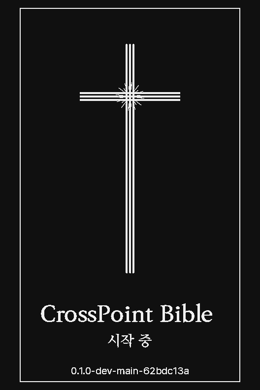 |  | 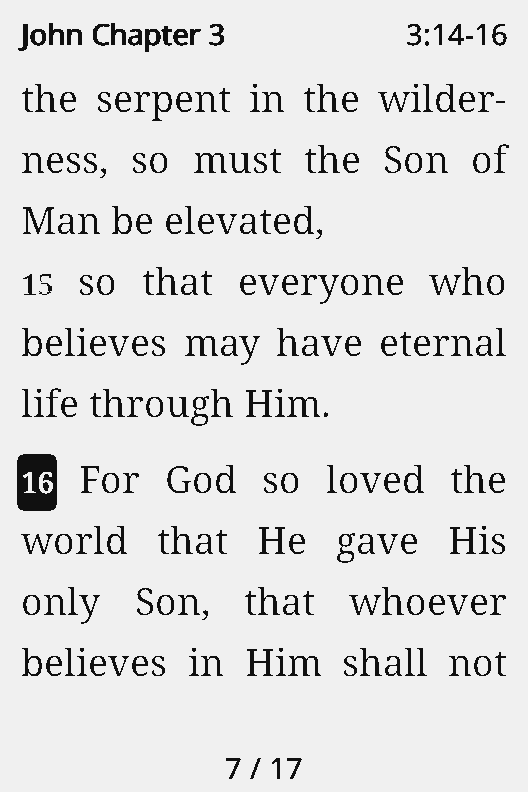 |  |

Screenshots are from the x4prosim emulator (X3, 528×792).

## Install

1. Download `crosspoint-bible-<version>-x4-x3.bin` from [Releases](https://github.com/crosspoint-reader-ko/crosspoint-bible/releases).
2. On a device running CrossPoint firmware: copy it to the SD card and pick it in Settings > System > SD Card Firmware Update.
3. Over USB: `esptool.py --chip esp32c3 write_flash 0x10000 crosspoint-bible-<version>-x4-x3.bin`.

Later updates also go through SD Card Firmware Update. The firmware has no network features.

## Languages

English is built in. For any other language, download its bundle and unzip it at the root of the SD card.

1. From the release, download `crosspoint-bible-<version>-<code>.zip` for each language you want (`ko` Korean, `ja` Japanese, `zh` Chinese, `es` Spanish, ...), or `crosspoint-bible-<version>-all.zip` for every language at once (about 55 MB). `en` holds the English Bible that is already built in, for a card that should carry its own copy.
2. Unzip it into the root of the SD card. The zip already contains the `bible/` folder, so the files land in `/bible/lang/<code>/` and `/bible/fonts/<code>/`. Several languages can share one card.
3. On the device, open the menu (Back) > Language, or Settings > System > Language. The list shows English and every installed language. Choosing one switches the menus, the Bible and the fonts together.

```
/bible/
  lang/
    ko/
      krv1961.cpb          개역한글 (1952/1961)
      otb.cpb              열린 성경
    ja/
      otb.cpb
  fonts/
    ko/
      KoPub 바탕/14.epdfont 16.epdfont 18.epdfont 22.epdfont 28.epdfont
      리디바탕/...
      ui/10.epdfont 14.epdfont 16.epdfont 22.epdfont   system font (sans-serif)
      LICENSES/
    ja/
      Noto Serif JP/...
      ui/...
```

- When a language has more than one Bible, the menu shows **Bible** to choose one (Korean: 개역한글, 열린 성경). When it has more than one reader font, the menu shows **Font** (Korean: KoPub 바탕, 리디바탕).
- Each bundle carries the language's sans-serif system font (Pretendard for Korean, Noto Sans JP/SC, Noto Sans Arabic, Vazirmatn, Noto Sans Hebrew). Switching language makes it the font of Settings, the menus and the lists; the Bible text uses the reader font.
- Latin and Cyrillic languages (da, de, es, fi, fr, id, is, it, nb, nl, pt, ru, so, sv, sw) use the built-in Noto Serif and Noto Sans, so their bundles hold only the Bible.
- The reading position and bookmarks carry over when you switch: every Bible uses the same 66-book numbering.

| Language list | 한국어 | 日本語 | العربية |
|---|---|---|---|
| 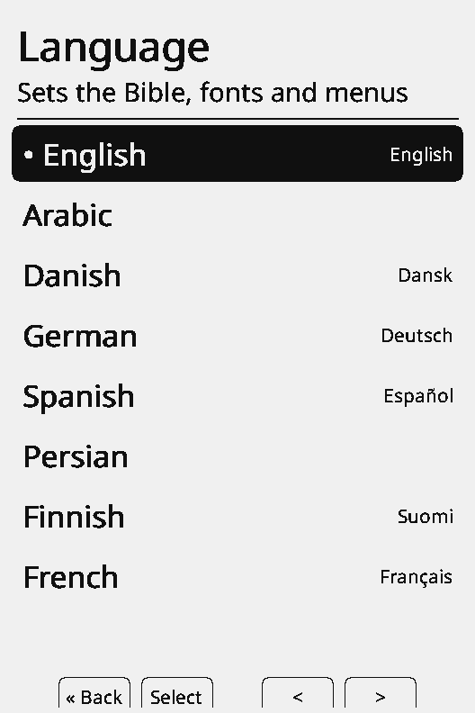 |  | 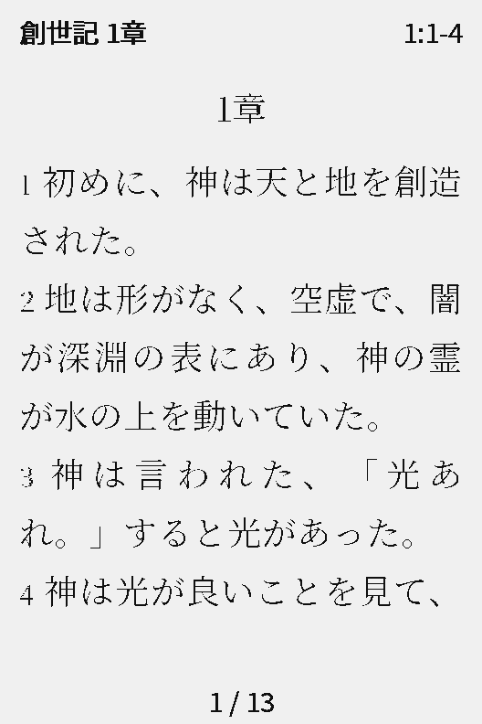 |  |

| 简体中文 | עברית | हिन्दी | Русский |
|---|---|---|---|
|  | 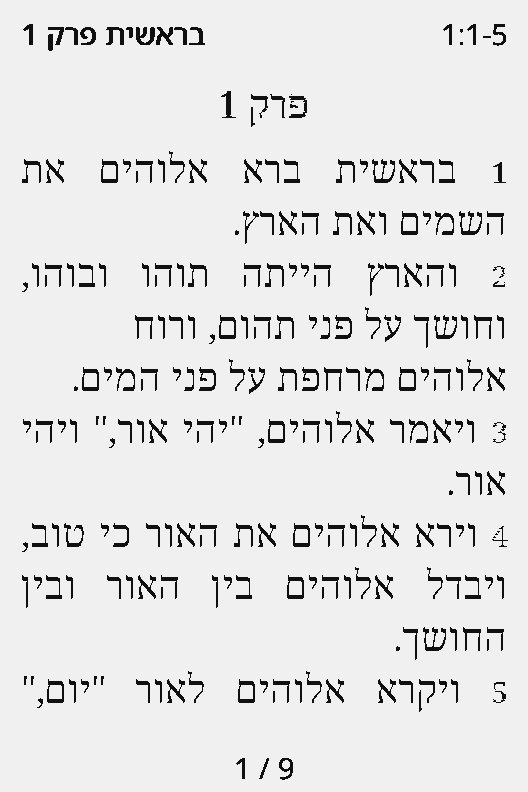 | 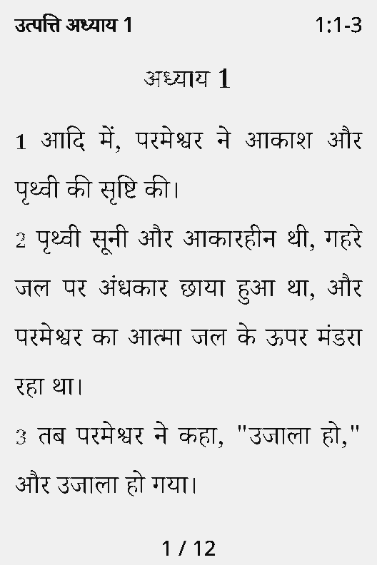 | 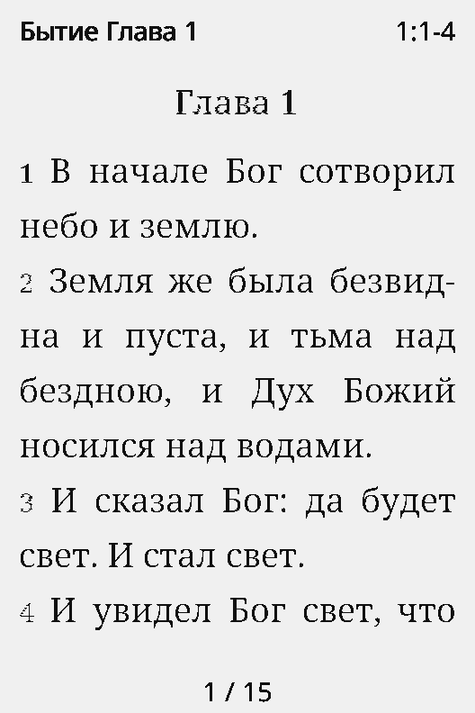 |

Scripts, fonts and pack metadata are described in [docs/languages.md](docs/languages.md).

## Use

### Reading

- The device opens where you left off.
- Left/right and the side buttons turn pages, across chapter and book boundaries. Hold to move a chapter.
- Confirm opens Go to. Back opens the menu.
- Defaults: 18 pt, normal line spacing, justified, one verse per line. English text is hyphenated.

### Go to

Pick the book from the Old/New Testament grid, then the chapter and the verse by number. Left/right moves one cell, the side buttons one row, holding a side button one page. On the chapter screen, hold Confirm to open at verse 1. The chosen verse is marked with a black box.

| Book | Chapter | Verse |
|---|---|---|
| 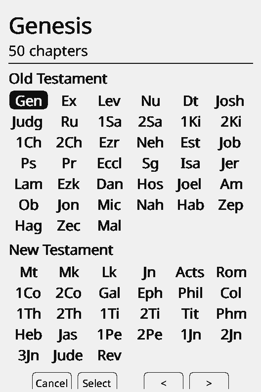 | 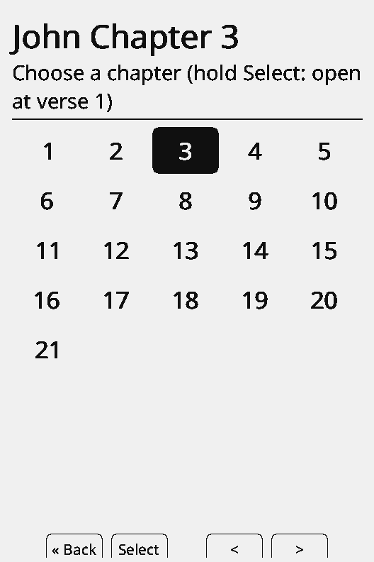 | 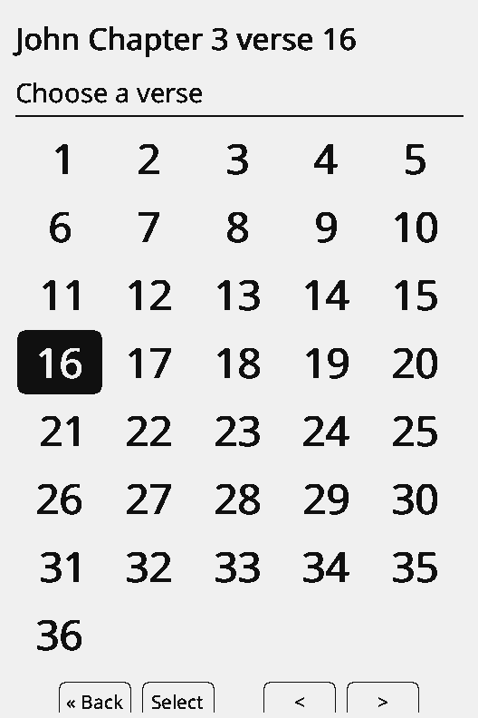 |

### Menu and view settings

Menu: Go to, Add bookmark, Bookmarks, Language, Bible, Font, Text size (14/16/18/22/28 pt), Line spacing, Layout (verse per line or paragraphs), Section titles, Smooth text, Orientation, About this Bible, Settings.

| Menu | 28 pt | 14 pt paragraphs | Left aligned |
|---|---|---|---|
| 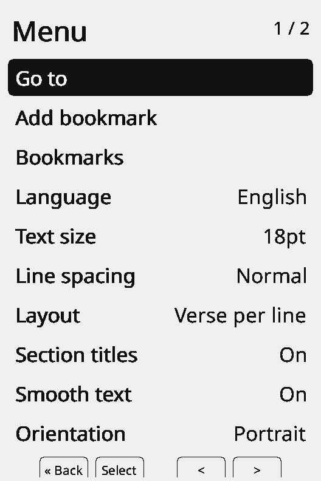 | 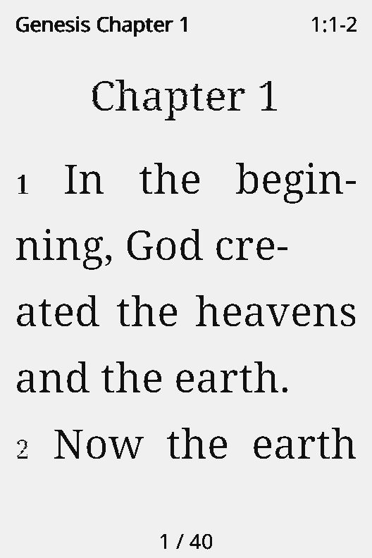 |  | 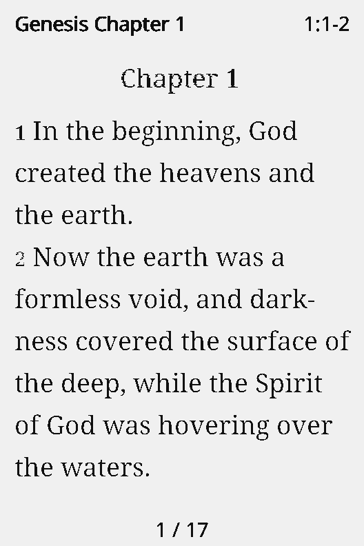 |

- Justified text keeps letter spacing fixed and spreads the leftover width over the spaces only. A line that would need gaps wider than about 2.5 spaces stays ragged. Korean, Chinese and Japanese break between characters; opening and closing punctuation follow line-breaking rules. Alignment is in Settings > Reader.
- With Smooth text (grayscale anti-aliasing) on, a page turn refreshes the screen twice; off, once.

### Bookmarks

Menu > Add bookmark: choose a folder or make a new one. Folder names are typed on the on-screen keyboard (Latin letters and digits; Korean adds 두벌식 Hangul). The saved verse is the one you jumped to, or the first verse on the page. Hold Confirm on a folder or bookmark to delete it. The file is `/.crosspoint/bible-bookmarks.txt` on the SD card.

| Choose a folder | New folder | Folders | Bookmarks | Delete |
|---|---|---|---|---|
| 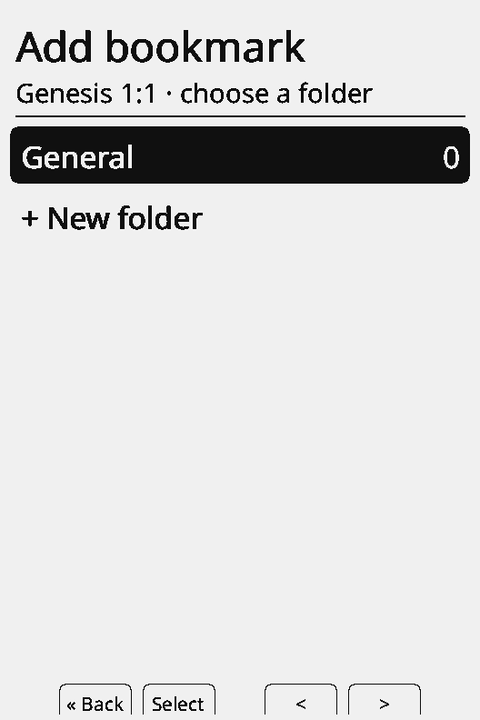 | 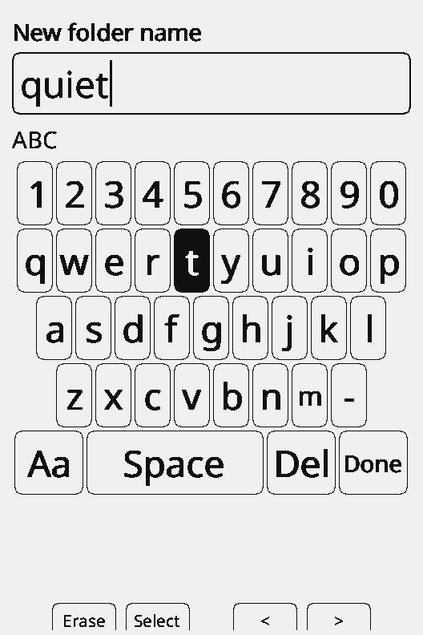 | 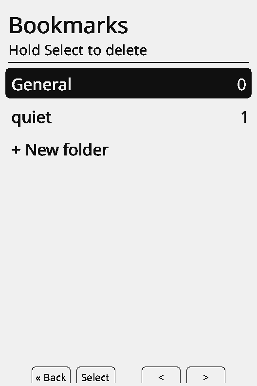 | 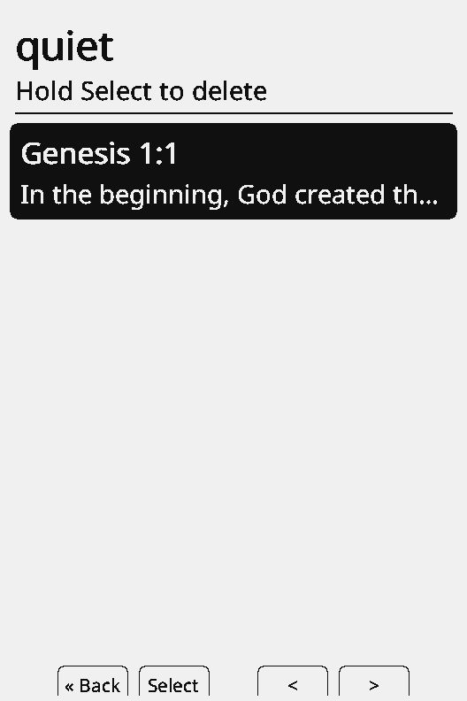 | 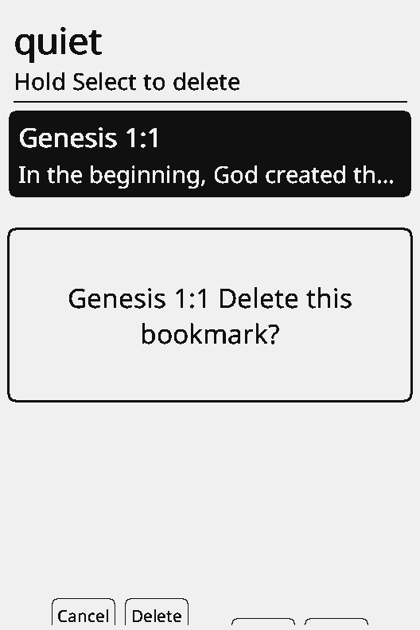 |

### About this Bible and settings

| About this Bible | Settings > Display | Settings > Reader | Settings > System |
|---|---|---|---|
| 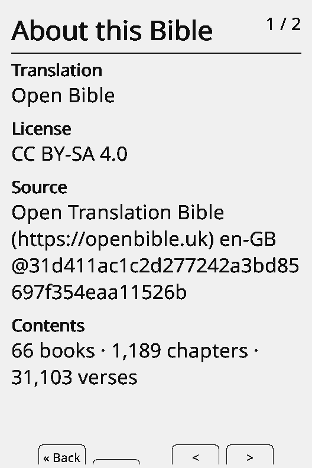 | 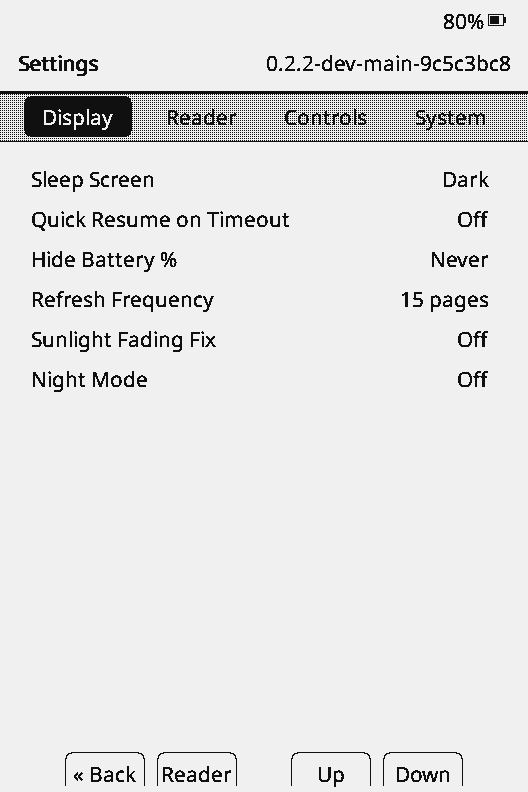 | 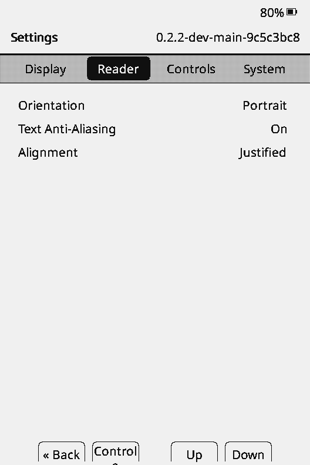 | 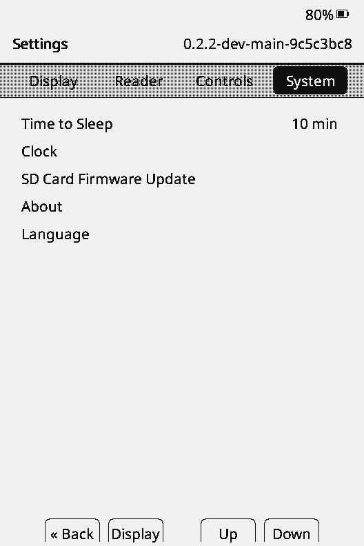 |

- About this Bible: name, edition, copyright or license, source, version, size (books, chapters, verses, section titles), language, location (built in or SD).
- Sleep screen: Dark (cover), Light (inverted cover), None, or Quick Resume (the current page with a moon).
- Settings > System: time to sleep, clock (on devices with an RTC), SD card firmware update, about, language.

## Your own Bible

`tools/bible/epub2cpb.py` converts an EPUB, a getBible v2 JSON file or an Open Translation Bible language folder into a `.cpb` pack. Put the pack in `/bible/lang/<code>/` to add it to that language (or in `/bible/`, where it joins its own language).

```sh
python3 tools/bible/epub2cpb.py MyBible.epub mybible.cpb --title "My Bible" --lang en
python3 tools/bible/epub2cpb.py korean.json krv1961.cpb --title 개역한글 --lang ko
```

Keep copyrighted translations for personal use and do not redistribute them. The format is in [docs/bible-pack-format.md](docs/bible-pack-format.md), the sources of the shipped packs in [data/bible/README.md](data/bible/README.md).

## Build

```sh
~/.platformio/penv/bin/pio run -e default            # development build
~/.platformio/penv/bin/pio run -e gh_release         # release build
~/.platformio/penv/bin/pio run -e default -t upload
```

The build embeds `data/bible/otb-en.cpb` (`scripts/embed_bible_pack.py`). `BIBLE_PACK` (a `.cpb`) or `BIBLE_EPUB` (EPUB or getBible JSON) embed another Bible; `BIBLE_EMBED=0` embeds none.

Language bundles:

```sh
git clone --filter=blob:none https://github.com/OpenTranslationBible/open-bible.git build/otb
git -C build/otb checkout 31d411ac1c2d277242a3bd85697f354eaa11526b   # the commit pinned in tools/bible/languages.json
pip install fonttools freetype-py uharfbuzz pillow
python3 tools/bible/bundle.py --otb build/otb                    # dist/bundles/crosspoint-bible-<version>-<code>.zip
python3 tools/bible/bundle.py --otb build/otb --lang ko ja       # some languages
python3 tools/bible/bundle.py --otb build/otb --lang --english data/bible/otb-en.cpb   # the built-in English pack
```

Fonts are downloaded at the versions in `tools/bible/fonts.lock.json` and subset to the characters each bundle uses. The release workflow builds the firmware and every bundle.

## Test

```sh
python3 tools/bible/test_epub2cpb.py
python3 tools/bible/test_shape.py
cmake -S test -B build/test && cmake --build build/test -j8
BIBLE_CPB=$PWD/data/bible/krv1961.cpb BIBLE_CPB_EN=$PWD/data/bible/otb-en.cpb ctest --test-dir build/test
sim/make-sd.sh             # SD card folders for the language scenarios, from dist/bundles
sim/screen-test.sh -b      # x4prosim emulator screen tests (needs ../x4prosim in the workspace)
```

The plan and progress are in [docs/bible-plan.md](docs/bible-plan.md).

## License

MIT ([LICENSE](LICENSE)), based on CrossPoint Reader and its Korean fork.

- Open Translation Bible: CC BY-SA 4.0, "Open Translation Bible (https://openbible.uk), CC BY-SA 4.0". The converted packs carry the same license.
- 개역한글 (1952/1961): public domain.
- Fonts: SIL Open Font License 1.1 (Noto, RIDIBatang, Pretendard, Vazirmatn) and the KoPub font terms (Korean Publishers Association). Each bundle includes the licenses of its fonts in `/bible/fonts/<code>/LICENSES/`.
